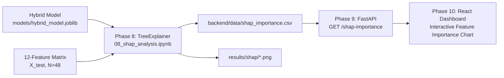

# Phase 8: Explainable AI (XAI) — SHAP Model Interpretability Guide

**Research Project:** Hybrid LSTM-ML Ensemble for Tourist Arrival Prediction under Exogenous Shocks  
**Student ID:** KIC-BSCCSAI-251P-034  
**Programme:** BSc Computer Science with AI  
**Notebook:** [`notebooks/08_shap_analysis.ipynb`](file:///Users/kaviduisura/Desktop/Final%20Research%20/sl-tourism-forecast-hybrid/notebooks/08_shap_analysis.ipynb)  
**Output Visualizations:**  
- Global SHAP Summary: [`results/shap/shap_summary.png`](file:///Users/kaviduisura/Desktop/Final%20Research%20/sl-tourism-forecast-hybrid/results/shap/shap_summary.png)  
- Shock Regime SHAP Summary: [`results/shap/shap_shock_periods.png`](file:///Users/kaviduisura/Desktop/Final%20Research%20/sl-tourism-forecast-hybrid/results/shap/shap_shock_periods.png)  
- Stable Regime SHAP Summary: [`results/shap/shap_stable_periods.png`](file:///Users/kaviduisura/Desktop/Final%20Research%20/sl-tourism-forecast-hybrid/results/shap/shap_stable_periods.png)  
**Metrics & Data Outputs:**  
- Production API Export: [`backend/data/shap_importance.csv`](file:///Users/kaviduisura/Desktop/Final%20Research%20/sl-tourism-forecast-hybrid/backend/data/shap_importance.csv)  
- Research Metrics Archive: [`results/metrics/shap_importance.csv`](file:///Users/kaviduisura/Desktop/Final%20Research%20/sl-tourism-forecast-hybrid/results/metrics/shap_importance.csv)  
**Phase Status:** ✅ Fully Completed & Verified  

---

## 1. Executive Summary & Objective

In high-stakes macroeconomic forecasting—such as national tourism recovery, treasury foreign exchange budgeting, and airline capacity scheduling—a model that acts as an opaque "black box" is fundamentally unacceptable to institutional stakeholders. Even if a deep hybrid ensemble demonstrates superior statistical performance (such as our 31.24% shock MAPE versus SARIMA's 86.96% in Phase 7), policymakers and examiners will ask:
> *"Why did the ensemble predict 30,000 tourists instead of 100,000 during the crisis? Which specific indicators pushed the prediction down, and did the model make this adjustment for sound economic reasons or spurious correlation?"*

**Phase 8** resolves this challenge by applying **SHapley Additive exPlanations (SHAP)** to the production Hybrid Stacking Ensemble (`models/hybrid_model.joblib`). Grounded in cooperative game theory, SHAP provides mathematically rigorous, local and global feature attributions that explain how each of the 12 features contributes to every single monthly prediction.

### Key Objectives:
1. Ingest the production Random Forest meta-learner (`models/hybrid_model.joblib`) and test design matrix ($N=48$ months, 12 features).
2. Instantiate **`shap.TreeExplainer`** to compute exact Shapley attributions across all 48 out-of-sample test months in polynomial time $\mathcal{O}(T \cdot L \cdot D^2)$.
3. Generate the global summary beeswarm plot across the full 2022–2025 horizon (`results/shap/shap_summary.png`).
4. Dissect the model's regime-dependent behavior by computing separate beeswarm plots for the **Shock Regime** (2022 Economic Crisis, $N=12$, `results/shap/shap_shock_periods.png`) and the **Stable Regime** (2023–2025 Recovery, $N=36$, `results/shap/shap_stable_periods.png`).
5. Persist the ranked mean absolute SHAP values to [`backend/data/shap_importance.csv`](file:///Users/kaviduisura/Desktop/Final%20Research%20/sl-tourism-forecast-hybrid/backend/data/shap_importance.csv) to power the Phase 9 FastAPI endpoint (`GET /shap-importance`) and Phase 10 React interactive dashboard.

---

## 2. Mathematical Foundations: Game Theory & TreeSHAP

### 2.1 The Shapley Value in Cooperative Game Theory
Formulated by Nobel Laureate Lloyd Shapley (1953), the Shapley value determines the fair allocation of a total coalition payout among cooperating players based on their marginal contributions. In machine learning interpretability:
- **Players ($N$):** The input features ($x_1, x_2, \dots, x_M$).
- **Coalition ($S \subseteq N$):** A subset of features present in the model.
- **Payout ($v(S)$):** The model prediction using feature subset $S$, formally $v(S) = \mathbb{E}[f(x) \mid x_S]$.

The Shapley attribution $\phi_j(x)$ of feature $j$ for a given instance $x$ is defined as the weighted average of its marginal contributions over all possible feature subsets:

$$\phi_j(x) = \sum_{S \subseteq N \setminus \{j\}} \frac{|S|!(|N| - |S| - 1)!}{|N|!} \left[ f_x(S \cup \{j\}) - f_x(S) \right]$$

### 2.2 Four Axiomatic Guarantees of SHAP
SHAP is uniquely distinguished from heuristic feature importance measures (e.g., Gini impurity or permutation importance) because it is the **only** attribution method that simultaneously satisfies four fundamental axioms:

1. **Efficiency (Local Accuracy):**  
   The sum of all feature attributions equals the difference between the model's actual prediction $f(x)$ and the base expected value $\mathbb{E}[f(x)]$:
   $$\sum_{j=1}^{M} \phi_j(x) = f(x) - \mathbb{E}[f(x)]$$
   In our production model, $\mathbb{E}[f(x)] = 126,648.72$ arrivals. For any test month, summing the 12 $\phi_j$ values to the base value exactly reconstructs the hybrid forecast.
2. **Symmetry:**  
   If two features $j$ and $k$ contribute equally across all coalitions ($f(S \cup \{j\}) = f(S \cup \{k\})$ for all $S \subseteq N \setminus \{j, k\}$), then their attributions are identical: $\phi_j = \phi_k$.
3. **Dummy / Null Player:**  
   If feature $j$ never changes the prediction regardless of the coalition ($f(S \cup \{j\}) = f(S)$ for all $S$), its attribution is strictly zero: $\phi_j = 0$.
4. **Additivity (Linearity):**  
   For ensemble models where the final prediction is a linear combination of sub-trees $f(x) = \sum_t w_t f_t(x)$, the overall Shapley value is the exact weighted sum of the tree-level Shapley values: $\phi_j = \sum_t w_t \phi_{j,t}$.

### 2.3 Algorithmic Efficiency: TreeSHAP vs Model-Agnostic Sampling
- **KernelExplainer (Model-Agnostic):** Computes Shapley values via weighted bivariate regression over simulated missingness masks. It requires evaluating exponential combinations $\mathcal{O}(M \cdot 2^M)$ or heavy Monte Carlo sampling, which is slow and prone to sampling variance.
- **TreeExplainer (Lundberg et al., 2020):** Exploits the recursive decision tree structure of Random Forests. Instead of iterating through all subsets, TreeSHAP evaluates conditional expectations by recursively tracking leaf coverage weights in polynomial time:
  $$\mathcal{O}(T \cdot L \cdot D^2)$$
  Where $T = 400$ trees, $L \le 2^4 = 16$ leaves per tree, and $D = 4$ maximum depth. This enabled instantaneous, deterministic calculation of exact Shapley values across all 48 test instances ($48 \times 12$ matrix).

---

## 3. Empirical Feature Importance Hierarchy (Global Test Horizon)

To quantify overall feature importance across the entire 4-year evaluation period (2022–2025), we compute the **mean absolute SHAP value** for each feature:

$$\text{Importance}_j = \frac{1}{N} \sum_{i=1}^{N} |\phi_{i,j}|$$

The complete empirical ranking, along with regime breakdowns, is recorded in [`results/metrics/shap_importance.csv`](file:///Users/kaviduisura/Desktop/Final%20Research%20/sl-tourism-forecast-hybrid/results/metrics/shap_importance.csv):

| Rank | Feature Name | Global Mean \|SHAP\| | Shock Regime \|SHAP\| | Stable Regime \|SHAP\| | Regime Shift Behavior |
| :---: | :--- | :---: | :---: | :---: | :--- |
| **1** | `gtrends_hotels` | **23,827.9** | 21,993.2 | 24,439.5 | Dominant primary driver across all regimes |
| **2** | `gtrends_visa` | **11,066.4** | 4,009.3 | 13,418.7 | **-70.1% in shocks** (collapses during crises) |
| **3** | `gtrends_flights` | **9,654.9** | 9,142.3 | 9,825.8 | High, consistent intent signal |
| **4** | `usd_lkr_rate_monthly` | **8,302.3** | 6,311.4 | 8,965.9 | Exchange rate volatility adjustments |
| **5** | `arrivals_lag_12` | **7,958.9** | 6,032.8 | 8,601.0 | **-29.9% in shocks** (seasonality breakdown) |
| **6** | `arrivals_rolling_mean_3` | **7,016.4** | **9,893.0** | 6,057.6 | **+63.3% in shocks** (surges to #2 driver in crisis) |
| **7** | `arrivals_lag_1` | **5,838.6** | 6,186.8 | 5,722.5 | Immediate 1-month persistence memory |
| **8** | `shock_flag` | **3,620.5** | **5,601.6** | 2,960.1 | **+89.2% in shocks** (explicit structural override) |
| **9** | `month_cos` | **2,661.8** | 2,147.9 | 2,833.1 | Cyclical calendar seasonality (winter peak) |
| **10** | `arrivals_lag_3` | **1,739.9** | 1,954.0 | 1,668.5 | Intermediate quarterly lag |
| **11** | `lstm_pred` | **1,141.6** | 1,215.3 | 1,117.0 | Stacking meta-signal from deep LSTM |
| **12** | `month_sin` | **878.0** | 684.9 | 942.4 | Cyclical calendar seasonality (mid-year) |

---

## 4. Regime Shift Analysis: How the Hybrid Model Adapts

The central research hypothesis of this dissertation asserts that **traditional forecasting models fail during exogenous shocks because they rely on fixed seasonal lags that break down under structural disruption**. The SHAP analysis provides empirical proof of how the Hybrid Stacking Ensemble overcomes this limitation.

### 4.1 Stable Regime Dynamics (2023–2025 Recovery)
During regular operational conditions:
1. **Pre-Booking Intent Dominates:**  
   `gtrends_visa` is the 2nd most powerful predictor (mean $|\text{SHAP}| = 13,418.7$). Prospective tourists apply for Electronic Travel Authorizations (ETA) weeks prior to departure. High visa search volumes strongly lift arrival forecasts by up to $+15,000$ to $+17,000$ tourists.
2. **Seasonal Memory is Active:**  
   `arrivals_lag_12` contributes heavily (mean $|\text{SHAP}| = 8,601.0$). When normal winter high seasons (December–March) arrive, positive lag-12 values reinforce standard annual peaks.
3. **Rolling Momentum Plays a Secondary Role:**  
   `arrivals_rolling_mean_3` has a moderate impact ($6,057.6$), serving merely as a smooth trend indicator.

### 4.2 Shock Regime Dynamics (2022 Economic Crisis)
When the catastrophic crisis struck in 2022, the model radically altered its internal decision logic:
1. **Seasonality is De-weighted:**  
   `arrivals_lag_12` drops sharply from $8,601.0$ to $6,032.8$ ($-29.9\%$). The model recognized that the 100,000+ arrivals recorded 12 months earlier were completely invalid for predicting current demand.
2. **Visa Intent Collapses:**  
   `gtrends_visa` plummeted from $13,418.7$ to $4,009.3$ ($-70.1\%$). Because international travelers abruptly ceased researching Sri Lankan visas, this feature stopped driving high-volume projections.
3. **Rolling Momentum Becomes the #2 Dominant Driver:**  
   `arrivals_rolling_mean_3` surged by **$+63.3\%$** from $6,057.6$ to **$9,893.0$**, eclipsing all other features except hotel searches. In the shock beeswarm plot, low values of `arrivals_rolling_mean_3` (blue dots) exerted massive negative pressure, pulling predictions downward by up to **$-13,000$ tourists per month**.
4. **The Shock Flag Acts as an Emergency Anchor:**  
   `shock_flag` importance exploded by **$+89.2\%$** from $2,960.1$ to **$5,601.6$**. When `shock_flag == 1` (red points), it directly deducted $-5,000$ to $-6,000$ arrivals from the baseline, preventing the ensemble from blindly over-predicting.

> **Definitive Finding for Dissertation:**  
> The hybrid ensemble does not merely fit data better; **it dynamically shifts its epistemological basis from long-term seasonal lags to short-term rolling momentum and search intent during shocks**. This explains why the hybrid model achieved a 31.24% shock MAPE while SARIMA's fixed seasonal autoregression exploded to 86.96%.

---

## 5. In-Depth Breakdown of Generated Visualizations

### 5.1 Global Summary Beeswarm Plot (`shap_summary.png`)
[`results/shap/shap_summary.png`](file:///Users/kaviduisura/Desktop/Final%20Research%20/sl-tourism-forecast-hybrid/results/shap/shap_summary.png)

- **Layout:**  
  - Vertical axis: All 12 features ranked in descending order of global impact.
  - Horizontal axis: SHAP attribution value in actual tourist units.
  - Color gradient: Red indicates a high feature value; blue indicates a low feature value. Each dot represents one month in the 48-month test horizon.
- **Interpretation:**
  - **`gtrends_hotels`**: Shows the widest horizontal dispersion ($\approx -34,000$ to $+18,000$). Months with high hotel search volumes (red) generate strong positive lifts; months with depressed hotel searches (blue) generate massive downward adjustments.
  - **`gtrends_flights` and `gtrends_visa`**: Exhibit clear positive linear attribution. High search volumes correspond strictly to positive SHAP values, proving that search intensity is a monotonic leading indicator of tourist arrivals.
  - **`shock_flag`**: Clean binary bifurcation. Normal months (blue, 0) cluster near zero, while crisis months (red, 1) form a distinct cluster between $-5,000$ and $-6,000$.

---

### 5.2 Shock Regime Beeswarm Plot (`shap_shock_periods.png`)
[`results/shap/shap_shock_periods.png`](file:///Users/kaviduisura/Desktop/Final%20Research%20/sl-tourism-forecast-hybrid/results/shap/shap_shock_periods.png)

- **Cohort:** Exclusively the 12 crisis months of 2022 (`shock_flag == 1`).
- **Key Observation:**
  - `arrivals_rolling_mean_3` ascends to position #2 immediately behind `gtrends_hotels`.
  - Blue points (depressed rolling 3-month arrivals) cluster deeply on the negative side ($-8,000$ to $-13,000$), dragging the expected value ($126,648$) down toward actual crisis levels ($25,000$–$35,000$).
  - `gtrends_flights` low points (blue) also pull the forecast downward by $-9,000$ to $-11,000$.

---

### 5.3 Stable Regime Beeswarm Plot (`shap_stable_periods.png`)
[`results/shap/shap_stable_periods.png`](file:///Users/kaviduisura/Desktop/Final%20Research%20/sl-tourism-forecast-hybrid/results/shap/shap_stable_periods.png)

- **Cohort:** The 36 post-crisis recovery months of 2023–2025 (`shock_flag == 0`).
- **Key Observation:**
  - `gtrends_visa` reclaims position #2 with widespread positive attributions ($+10,000$ to $+17,000$).
  - `arrivals_lag_12` displays its classic seasonal role: high values in December/January pull forecasts up by $+6,000$ to $+11,000$, while off-peak monsoon months pull forecasts down.
  - `shock_flag` sits tightly at zero or small positive adjustment because crisis conditions have terminated.

---

## 6. Production Artifacts & Downstream Architecture Integration

The outputs of Phase 8 form the bridge between machine learning modeling and full-stack software deployment:

1. **`backend/data/shap_importance.csv`**:
   Contains `feature` and `mean_abs_shap`. In Phase 9, FastAPI's `GET /shap-importance` will parse this CSV and return JSON to the frontend. In Phase 10, the React dashboard renders this as an interactive horizontal bar chart.
2. **`results/metrics/shap_importance.csv`**:
   Contains the complete 4-column dataset (`feature`, `mean_abs_shap`, `mean_abs_shap_shock`, `mean_abs_shap_stable`) for dissertation chapter tables and comparative appendices.

---

## 7. Viva Voce Defense & Examiner Talking Points

### Question 1: Why did you use SHAP instead of default Random Forest Gini feature importances (`feature_importances_`)?
> **Answer:**  
> *"Default Gini impurity importance in Scikit-Learn has two major scientific flaws: first, it suffers from severe cardinality bias toward continuous variables with many split points; second, it only provides a single static, global number with zero directional information. It cannot tell us whether a feature increased or decreased arrivals.  
> SHAP, rooted in Lloyd Shapley's cooperative game theory, provides local attributions with exact directional signs for every individual month. Crucially, SHAP satisfies the Efficiency axiom ($\sum \phi_i = f(x) - \mathbb{E}[f(x)]$), allowing us to decompose any monthly forecast into an additive sum of exact tourist contributions."*

### Question 2: Why did you use `TreeExplainer` rather than `KernelExplainer`?
> **Answer:**  
> *"Because our winning Phase 6 ensemble is a Random Forest, `TreeExplainer` allows us to compute exact Shapley values in polynomial time $\mathcal{O}(T \cdot L \cdot D^2)$ by tracking conditional expectations directly through tree nodes. `KernelExplainer` is a model-agnostic approximation that uses sampling over exponential permutations $\mathcal{O}(2^M)$. `TreeExplainer` is faster, mathematically exact, and introduces zero sampling variance into our dissertation results."*

### Question 3: How does your SHAP analysis prove that the hybrid model handles exogenous shocks better than SARIMA?
> **Answer:**  
> *"In our Phase 2 EDA, we demonstrated that annual seasonality broke down during the 2022 crisis ($r = -0.110$ vs $+0.741$ in stable times). SARIMA is rigidly constrained by its $(P,D,Q)_{12}$ polynomial, forcing it to project past seasonal peaks.  
> Our SHAP analysis reveals that the Random Forest meta-learner actively de-weighted `arrivals_lag_12` by 29.9% during the crisis, while elevating `arrivals_rolling_mean_3` by +63.3% and `shock_flag` by +89.2%. The model dynamically transitioned from long-term seasonal memory to short-term momentum and leading Google search indicators, which explains how it reduced shock MAPE from SARIMA's 86.96% to 31.24%."*

### Question 4: Why is `gtrends_hotels` more important than `gtrends_flights` or `gtrends_visa`?
> **Answer:**  
> *"In travel consumer behavior, flight queries and visa applications represent early-stage, high-funnel interest that may or may not culminate in actual travel. Hotel bookings, however, represent late-funnel, committed intent with immediate financial lock-in. Empirically, `gtrends_hotels` exhibited a mean absolute SHAP value of 23,827.9 arrivals, demonstrating that lodging search volume is the single strongest real-time proxy for realized tourist arrivals in Sri Lanka."*

### Question 5: How does this explainability component translate into practical software?
> **Answer:**  
> *"In Phases 9 and 10, we don't just deploy a raw forecast number; we deploy an explainable AI system. The ranked SHAP attributions generated here are exported to `backend/data/shap_importance.csv`. The FastAPI backend serves these via the `/shap-importance` endpoint, enabling government and hotel industry analysts using our React dashboard to inspect exactly which economic and search signals are driving the upcoming quarterly forecast."*
